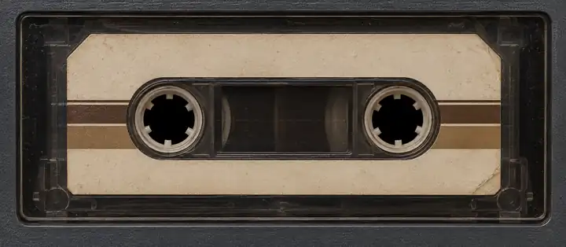
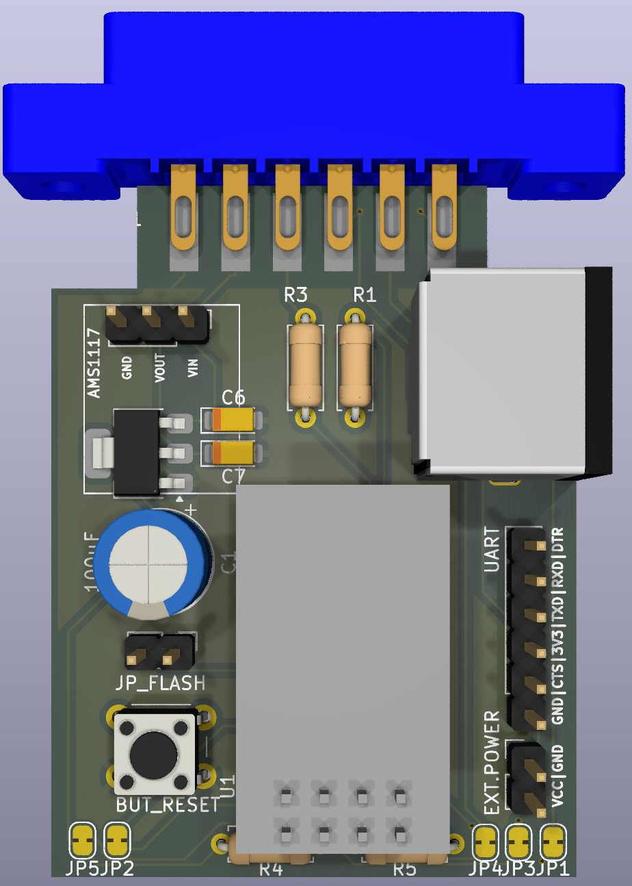
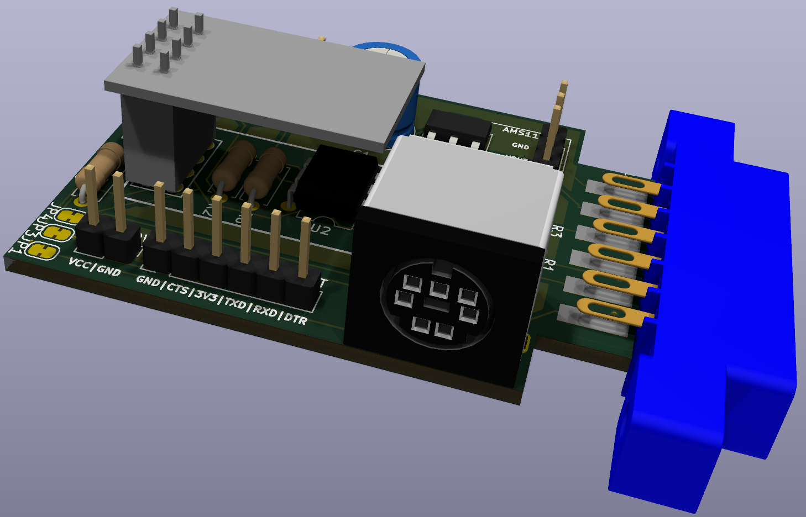

# ESPsette

**[Open the browser demo](https://ytmytm.github.io/ESPsette/)** — simulated ESP, no hardware needed.

**A Wi-Fi cassette deck for your Commodore, built around an ESP-01.** Open its page, drop a tape file and type `LOAD` on the computer. Your browser streams the file over Wi-Fi; the ESP8266 turns it into timed I2S pulses on the datasette READ line. The computer controls MOTOR, and the page controls the virtual PLAY key through SENSE.

Small as a *pesette* — a little scale for your LOADs.

Files stay in the browser and pass through an 8 KB buffer on the ESP. No SD card or tape storage in flash is needed.



## Tested and pending

Hardware tests on **1 November 2026**:

| Feature | Status |
| --- | --- |
| C64 loading the embedded demo TAP | Passed on real hardware |
| C64 loading a TAP streamed from the browser | Passed on real hardware |
| PRG → standard tape pulses, C64 and C16/Plus/4 PAL/NTSC | Host tests pass; hardware test pending |
| C16/Plus/4 playback; all supported TAP v1/v2 variants | Full hardware coverage pending |
| IDX seeking and counter-based REW/FF | Host tests pass; hardware test pending |
| WRITE command requests | Header validation and ESP: request publication pass host tests; hardware test pending; no command handlers yet |
| Turbo loader | Selectable PRG bootstrap + GPIO sender; C64/C16/Plus/4 host/VICE tests pass; hardware test pending |
| OTA updates | Disabled in the default firmware; use serial flashing |

## Hardware

The [KiCad project](kicad/espsette.kicad_pro) includes the schematic, routed PCB and project-local libraries. See the [wiring notes](kicad/WIRING.md) and [connection plan](kicad/PLAN_POLACZEN.md) for the selected circuit.

- [Schematic PDF](kicad/plots/espsette.pdf)
- [Gerber and drill files](kicad/gerbers/)
- [Local symbols, footprints and 3D models](kicad/libraries/README.md)





## Build

Requires `make`, `curl`, Python 3 and **ACME** (6502 assembler), plus internet access for the initial tool download.
Install ACME with `sudo apt-get install acme` on Debian/Ubuntu or `brew install acme` on macOS. Host tests also use a C++17 compiler and Node.js. On macOS, install the Command Line Tools if needed (`xcode-select --install`). Run from the repository root:

```sh
make setup                    # Install project tools once
make native                   # Assemble C64 and C16/Plus4 loaders with ACME
make build PROFILE=1m         # Assemble loaders and build for a 1 MB ESP-01
```

Tools are installed in `tools/`, with Python and PlatformIO packages/caches under `~/.cache/ESPsette/`. No global PlatformIO installation is required. The default build enables real cassette GPIOs and includes the demo TAP. Build settings are in [platformio.ini](platformio.ini).

| Profile | Use |
| --- | --- |
| `1m` (default) | 1 MB flash, 64 KB LittleFS |
| `4m` | ESP-01 with 4 MB flash |
| `512k` | 512 KB flash; current firmware may not fit |

## PRG fastloader

Open **Playback settings**, enable **Use fastloader for PRG**, and save before
inserting a PRG. The default is off. With it off, PRGs use the standard ROM
protocol. TAP playback keeps its recorded timing. With it on, normal `LOAD`
autostarts a small header bootstrap, then direct GPIO drives READ together
with WRITE/SENSE to transfer the receiver and program. I2S is stopped before
the fast stage. The current firmware accepts fast PRGs in `$0801..$7FFF`
on C64 and `$1001..$3FFF` on C16/Plus4, and selects BASIC RUN by default.
The session API can supply a decimal `entry` address for machine code.

The same panel edits setup, data hold, gaps between pairs/bytes, bootstrap
hold/gap, and MOTOR settling times in microseconds. C64 and C16 have separate
hold and byte-gap values. **Save fastloader settings** stores the complete
configuration atomically in LittleFS at `/fastloader.json`; it survives resets
and applies to the next inserted PRG. **Default timings** restores the fields
without changing the enabled switch; save to apply. Settings cannot be changed
during an active transfer. A missing or invalid file uses the tested defaults.
If hardware fails to load, increase the relevant delays or switch fastloader off.

Native sources live in [`native/fastloader/`](native/fastloader/).
`make native` generates the ignored `include/fastloader_native.h`; PlatformIO's
pre-build hook regenerates it automatically for all profiles. A post-link check
verifies that the GPIO transmitter and busy wait reside in IRAM. The firmware
GitHub Actions workflow installs ACME, assembles both targets, runs sender,
settings, wire-order and cycle-budget tests, then builds the ESP image.
[Protocol, timing and emulator tests](experiments/fastloader/README.md) describe
the three stages and the limits of simulation. Hardware verification is pending.

During fastloading the deck shows payload bytes sent/remaining, percentage,
measured average kB/s and an estimated remaining transfer time. Counts come
from completed ESP payload blocks, not browser upload progress or a fixed
9 kB/s assumption. Pauses for source data or the receiver hold the progress
and reel animation while screen sleep protection remains active. Completed
PRGs remain at 100% until rewound or ejected.

The VFD and mechanical counter show **virtual tape time**: the standard ROM
signal duration of the transmitted bytes, including both ordinary copies.
They advance rapidly as fast data arrives. Reels switch to a clearly faster animation during the fast receiver and payload stages
(0.28 s per turn instead of 1.6 s).
The existing reduced-motion preference still applies. The payload meter and
ETA show actual transfer progress; virtual tape minutes are not wall-clock
minutes. Preview simulates fast speed from the saved timing settings.

## WRITE command requests

The computer can send an `ESP:` request name through a standard WRITE header,
for example `SAVE "ESP:TEST",1`. The ESP verifies both copies and publishes the
request in **Playback details** and `/state`. Ordinary names such as
`SAVE "NAZWA",1` also appear there as the last verified header, without becoming
commands. The ESP ignores all following program
data and creates no file. This restores the command transport, not recording.
Command handlers are not implemented yet, so verified requests are shown as
received without execution. GPIO2 is reserved for fastloading throughout a
selected fast PRG session; finish or eject it before sending WRITE requests.
The WRITE ISR checks MOTOR high on each edge and rejects capture throughout
a selected fastloader session; its interrupt is detached during that session.
See [WRITE command protocol](docs/WRITE-COMMANDS.md) for the procedure, validation,
state fields and GPIO ownership.

## Flash over USB-UART

Download the `.bin` from [Releases](https://github.com/ytmytm/ESPsette/releases), or build it locally. Each release includes `FLASHING.txt` with the command for flashing the binary at `0x0`, plus SHA-256 checksums. The released image targets a **1 MB ESP-01** and includes the demo; no separate filesystem image is needed.

Disconnect the ESP-01 from the Commodore interface. Use **3.3 V power and 3.3 V UART logic**, with a supply able to handle Wi-Fi current peaks. On a USB-C Mac, use a suitable adapter for your USB-UART programmer.

CH340G adapters such as [4tronix USB340G](https://shop.4tronix.co.uk/products/usb340g) have a voltage switch: **select 3.3 V before powering** and verify VCC and signal levels on the actual adapter. Our planned PCB header matches `GND / CTS / VCC / TXD / RXD / DTR`; CTS is unused. **Adapter TXD connects to ESP RXD, and adapter RXD to ESP TXD** (the PCB routes this crossover).

If the CH340 adapter does not appear as a serial port, check its driver. [HobbyComponents CH340 drivers](https://github.com/hobbycomponents/ch340-drivers) provides Windows drivers and notes that Linux usually includes a suitable driver.

**Keep GPIO0 shorted to GND throughout flashing. Connect the adapter's DTR to ESP RST.** These are the connections used by our CH340/wemos.cc setup and [esptool.cfg](esptool.cfg):

| USB-UART / supply | ESP-01 |
| --- | --- |
| 3.3 V | VCC and CH_PD / EN |
| GND | GND **and GPIO0** (flash jumper) |
| TXD | RXD / GPIO3 |
| RXD | TXD / GPIO1 |
| **DTR** | **RST** |
| No connection | GPIO2 (must remain HIGH at reset), CTS, RTS |

The configured reset sequence pulses **DTR only**; it does not use RTS. For a programmer without DTR, enter flash mode by briefly pulling RST to GND while GPIO0 is grounded.

```sh
ls /dev/cu.*                                  # Find the port on macOS
make flash-id PORT=/dev/cu.usbserial-XXXX       # Check the actual flash size
make flash PROFILE=1m PORT=/dev/cu.usbserial-XXXX
```

`make flash` also builds the firmware. On Linux, use your port such as `/dev/ttyUSB0`. `make chip-info PORT=...` prints additional chip information.

**After flashing:** remove the GPIO0–GND jumper, disconnect DTR–RST and reset the module. GPIO0 must be HIGH at reset to run the firmware. See [wiring notes and ESP-01 connections](kicad/WIRING.md) before reconnecting the Commodore interface.

OTA is disabled because the 1 MB image with the embedded demo leaves insufficient space for a second image. The existing `make ota` target requires firmware built with OTA enabled and enough free flash; it is not ready for the default setup.

## Load a tape

1. Connect MOTOR → GPIO0, SENSE ← GPIO1 and READ ← GPIO3 through the interface described in [kicad/WIRING.md](kicad/WIRING.md). C16/Plus/4 needs a 1531 connector or adapter.
2. On first boot, join `ESPsette-XXXXXX` and configure Wi-Fi in the captive portal. The device falls back to its AP if the saved network fails. No Wi-Fi credentials are built in.
3. Open `http://DEVICE_IP/` (find the IP in your router). The default hostname is `ESPsette`; `.local` resolution is not guaranteed.
4. Use **Demo** or **TAP / TAP+IDX / PRG** directly below the deck (drag and drop onto the deck or picker also works). TAP and PRG files are inserted immediately. PRG uses the default C64 PAL, C64 NTSC, C16 PAL or C16 NTSC profile from **Playback settings** and the filename as its tape name; the ESP generates the tape header and data pulses. Computer settings persist on the ESP in LittleFS. When multiple files are selected, the first TAP/PRG and (for TAP) the first IDX are used, regardless of order or extension case. Add an Ultimate-style `.idx` together with a TAP or later through the same picker or drop area. With IDX, choose a named position in the deck and press **JUMP**, or use **PREV/NEXT**. The list and handwritten cassette title follow the position being played. Elapsed and total time refer to the whole TAP, including after a jump.
5. **Autoplay** on the deck presses virtual PLAY when a tape is inserted; otherwise press PLAY on the page. Type `LOAD` on the Commodore. Playback starts when MOTOR turns on and pauses whenever MOTOR stops, including after the header.

The four profiles use the tape clocks from [VICE `vice/src/tape/tap.c`](https://github.com/VICE-Team/svn-mirror/blob/main/vice/src/tape/tap.c):

| Profile | Tape clock |
| --- | ---: |
| C64 PAL | 985248 Hz |
| C64 NTSC | 1022730 Hz |
| C16 PAL | 886724 Hz |
| C16 NTSC | 894886 Hz |

C16 cassette timers use the slow clock (half the CPU clock). TAP v1/v2 selects PAL/NTSC from header byte 14; the PRG default does not override TAP metadata. Old saved `c64`/`c16` settings are interpreted as PAL. Repeating the active profile does not write flash, including when using a legacy PAL alias. NTSC has host-side coverage; real NTSC hardware still needs testing.

Keep the browser tab visible while streaming. During actual playback (PLAY pressed, MOTOR on, no playback error), the page requests screen sleep protection and releases it on pause, stop, completion or connection failure. Fastloader PRG keeps protection through bootstrap MOTOR pauses and the entire GPIO transfer, including buffer waits, regardless of MOTOR/SENSE levels or the ordinary playback flag; STOP, completion, errors and connection failure release it. **Playback details** shows whether protection is active or blocked. HTTPS/localhost uses the browser [Screen Wake Lock API](https://developer.mozilla.org/en-US/docs/Web/API/Screen_Wake_Lock_API); ordinary ESP HTTP uses a browser-dependent silent-video fallback with bundled [NoSleep.js media](web/assets/wake/README.md). A tap may be needed to unlock it; use **Keep screen awake** if offered. STOP is a momentary key: it springs back visually when released, leaving PLAY released and the deck stopped. The page retries when returning to the foreground. Screen wake protection cannot guarantee background execution, override manual locking/lid closure, or bypass OS power-saving restrictions. PLAY/STOP control SENSE; the Commodore controls MOTOR. REW/FF seek while MOTOR is stopped. The animated cassette and counter show playback progress. Settings live in LittleFS; tape files stay in the browser. The page is intended for a trusted LAN and has no login.

## Debug and local UI preview

Expand **Playback details → Debug / ESP state** on the page, or connect to colored RemoteDebug logs:

```sh
nc DEVICE_IP 23
```

Normal firmware has no UART log: GPIO1 and GPIO3 are used for SENSE and READ.

Open [web/player.html](web/player.html) directly in a browser or run `make preview` to try the UI with simulated ESP state. Caveat is bundled as WOFF2 assets and embedded in the firmware, so it works offline without installed fonts or external requests. Font sources and OFL licenses are in [web/assets/fonts](web/assets/fonts). **Fastload PRG demo** runs a built-in sample with a shortened bootstrap, byte progress, accelerated counter/reels and configured timing. **Pause receiver** demonstrates a stalled transfer while keeping screen protection active. **Simulate SAVE "NAZWA"** and **Simulate ESP:TEST** show received header/request metadata; they wait until the fastload has finished or is ejected. These controls are available only in preview/demo mode and do not contact hardware. Preview saves the default computer, autoplay and fastloader settings in browser local storage; real firmware saves these settings on the ESP. See [tests/README.md](tests/README.md) for host tests and `make help` for build targets.

For manual UI testing, use [ui-test.tap](tests/fixtures/ui-test.tap) with [ui-test.idx](tests/fixtures/ui-test.idx): a two-minute synthetic tape with six navigation markers. See [fixture instructions](tests/fixtures/README.md).

The hosted demo is built from the same `web/player.html` by `scripts/build-demo.py`. It always uses simulated ESP state and includes downloadable TAP/IDX samples. GitHub Pages is updated automatically by `.github/workflows/demo.yml` after changes to the UI on `main`.

## CI and releases

GitHub Actions runs host tests and compiles the default 1 MB firmware on code pushes, pull requests and manual runs. Download the package from the run's **Artifacts** section; it contains the `.bin`, debug ELF, build metadata, checksums and flashing instructions.

To release, publish a GitHub Release with a tag such as `v2026-11-01` pointing to the desired commit. The workflow builds that tag and automatically attaches the same files to the release. Tags must use `vYYYY-MM-DD` with a valid calendar date. Pushing a tag alone does not publish a release. Experimental OTA profiles are not included.

## References

- [Ultimate Tape Archive](https://uta.pokefinder.org/) — preserved C64 and VIC-20 tapes.
- [VICE TAP format](https://vice-emu.sourceforge.io/vice_17.html) and [datasette counter model](https://github.com/VICE-Team/svn-mirror/blob/main/vice/src/datasette/datasette.c).
- [Tapuino](https://github.com/sweetlilmre/tapuino) and [TapuinoNext](https://github.com/sweetlilmre/TapuinoNext).
- [TAP/IDX notes](https://www.luigidifraia.com/technical-info/#TAP_Index_format_IDX) and [Ultimate index implementation](https://github.com/GideonZ/1541ultimate/blob/master/software/filetypes/filetype_tap.cc).
- [ESP8266 boot modes](https://docs.espressif.com/projects/esptool/en/latest/esp8266/advanced-topics/boot-mode-selection.html), [PlatformIO](https://docs.platformio.org/en/latest/platforms/espressif8266.html) and [Arduino OTA](https://arduino-esp8266.readthedocs.io/en/latest/ota_updates/readme.html).

No license has been selected yet.

## Release checklist

- [ ] Choose the release commit and confirm its GitHub Actions tests and firmware build pass.
- [ ] Download its artifact, verify `SHA256SUMS.txt` and flash the packaged 1 MB `.bin` using `FLASHING.txt`.
- [ ] Check cold boot/reset with MOTOR stopped, Wi-Fi setup/fallback, and the player page on desktop and phone.
- [ ] On a real C64, load both the embedded demo and a browser-streamed TAP; check the MOTOR pause after the header, resume and completion.
- [ ] Test any newly advertised feature on hardware; update the tested/pending table and release notes with the actual results and limitations.
- [ ] Confirm the wiring and flashing instructions match the tested setup.
- [ ] Publish a GitHub Release for that commit with a valid `vYYYY-MM-DD` tag and concise release notes.
- [ ] Wait for the release workflow to pass; confirm the `.bin`, ELF, metadata, `FLASHING.txt` and checksums are attached to the release.
